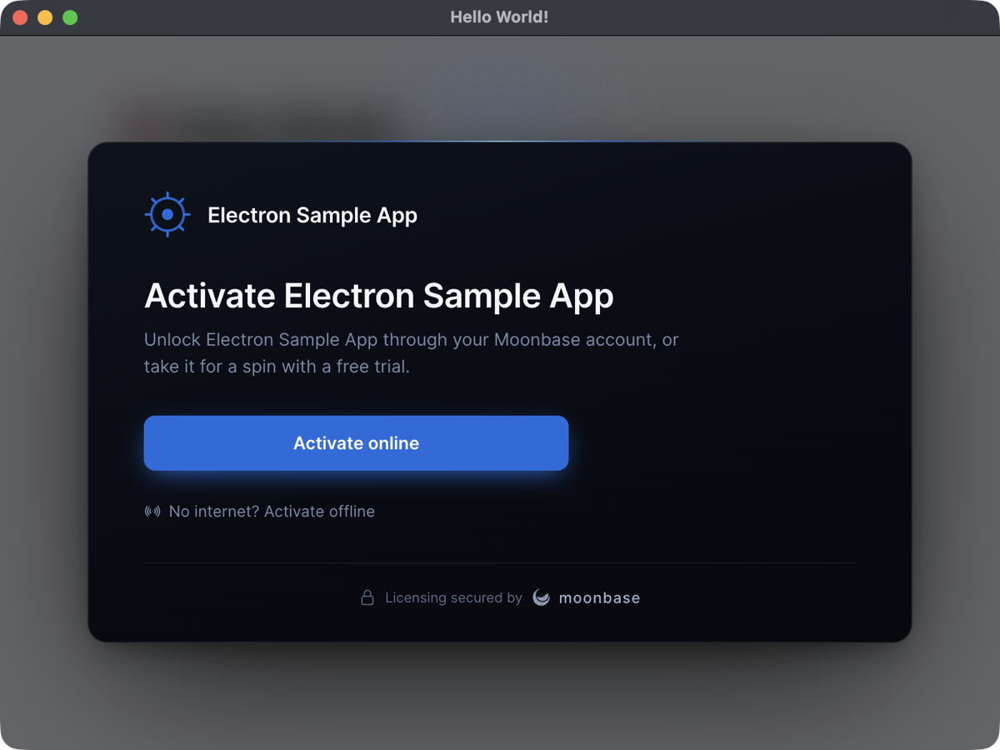
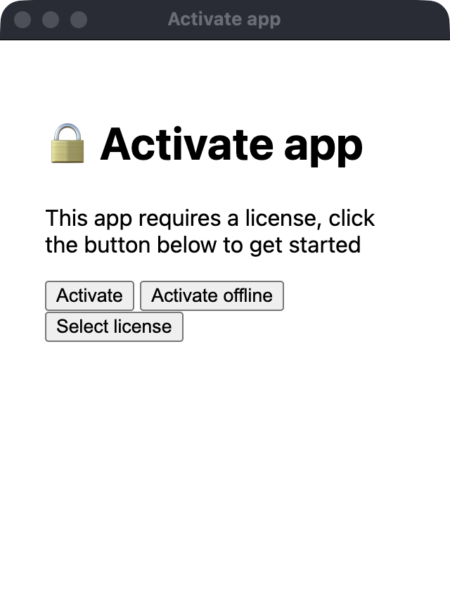

# Moonbase.sh Electron Sample Apps

These apps show two ways to integrate Moonbase.sh for licensing into an Electron app.
Both are based on the vite-typescript Electron Forge template, run all the licensing code in the main process to get privileged access to system information for fingerprinting, and are wired to Moonbase's public demo store (`demo.moonbase.sh`, product `demo-app`), so they activate out of the box.

| Example | Package | Pick it when |
| --- | --- | --- |
| [Built-in UI](#built-in-ui-moonbaseshelectron) | [`@moonbase.sh/electron`](https://www.npmjs.com/package/@moonbase.sh/electron) | You want a finished activation UI: online and offline activation, trials, license details, deactivation and updates, with no renderer code |
| [Custom UI](#custom-ui-moonbaseshlicensing) | [`@moonbase.sh/licensing`](https://www.npmjs.com/package/@moonbase.sh/licensing) | You want to design the activation flow yourself, and drive the SDK directly |

Each example is a standalone app, so you can copy either folder to start your own.

## Getting started

Clone the repo, pick an example, and run the start script:

```bash
cd built-in-ui # or custom-ui
npm install
npm run start
```

## Built-in UI: `@moonbase.sh/electron`



[`@moonbase.sh/electron`](https://www.npmjs.com/package/@moonbase.sh/electron) builds on the licensing SDK, and brings the same activation UI as Moonbase's JUCE module and Tauri plugin.
It validates the stored license at startup, presents the UI whenever the app has no license, and keeps watching the license while the app runs.
In this example the UI is laid over the main window, which stays blurred and locked until the app is licensed.

### Add the module

We ran `npm install --save @moonbase.sh/electron`, and then created the [licensing.ts](./built-in-ui/src/licensing.ts) file to store the configuration in:

```ts
import { createMoonbase } from "@moonbase.sh/electron"

// The license is kept in license.mb in the app's user data folder, and
// app.getVersion() is reported to Moonbase, so neither needs setting here
const moonbase = createMoonbase({
    productId: 'demo-app',
    endpoint: 'https://demo.moonbase.sh',
    publicKey: `-----BEGIN RSA PUBLIC KEY-----
...
-----END RSA PUBLIC KEY-----`,

    // The built-in activation UI, which presents itself whenever the app has no license
    ui: {
        productName: 'Electron Sample App',

        // Lay the activation UI over the main window, which stays locked until the
        // app is licensed. Leave this out to show it in a window of its own instead,
        // for an app that stays usable without a license.
        presentation: 'overlay',
    },

    // The main window only shows the license and opens the activation UI, so that
    // is all its renderer may do through window.moonbase
    rendererAccess: 'read-only',
})

export default moonbase
```

The UI can carry your brand: an accent colour, your logo, the features of your trial, and your own copy for every screen.
See [the activation UI options](https://www.npmjs.com/package/@moonbase.sh/electron#the-activation-ui) for all of them.

### Start it

[main.ts](./built-in-ui/src/main.ts) starts the module and opens the main window right away. There is no license check to write: while the app has no license, the module locks that window.

```ts
const start = () => {
  moonbase.start();
  createWindow();
};

app.on('ready', start);
```

On macOS the app stays open after its last window closes, and the overlay closes with that window, so a window opened from the dock is locked again:

```ts
app.on('activate', () => {
  if (BrowserWindow.getAllWindows().length === 0) {
    createWindow();

    // The activation UI closed with the last window, so lock the new one too
    if (!moonbase.isLicensed()) {
      void moonbase.present();
    }
  }
});
```

The overlay locks the interface, so gate your paid features in the main process too, where a renderer cannot skip the check:

```ts
if (!moonbase.isLicensed()) {
  void moonbase.present();
  return;
}
```

### Show the license in the app

The [preload script](./built-in-ui/src/preload.ts) exposes the module's renderer API as `window.moonbase`:

```ts
import { exposeMoonbase } from "@moonbase.sh/electron/preload";

exposeMoonbase()
```

The [renderer](./built-in-ui/src/renderer.ts) then shows the license, and updates it whenever it changes. The **Manage license** button opens the built-in license details, where the customer can copy their license ID for support or deactivate this device:

```ts
moonbase.onStateChanged(render)
render(await moonbase.state())

document.getElementById('manage-license').addEventListener('click', () => moonbase.present({ screen: 'license' }))
```

To build your own UI on top of the module instead, pass `ui: false` and drive activation through `window.moonbase` with the default `rendererAccess`.

### Keep the module out of the bundle

The module loads its activation UI from its own folder in `node_modules`, but Electron Forge's Vite plugin bundles every dependency into the main process and packages nothing but its own build.
So [vite.main.config.ts](./built-in-ui/vite.main.config.ts) leaves the module out of the bundle:

```ts
export default defineConfig({
  build: {
    rollupOptions: {
      external: ['@moonbase.sh/electron'],
    },
  },
});
```

And [forge.config.ts](./built-in-ui/forge.config.ts) ships the production dependencies in `node_modules` alongside the build. Electron Packager leaves out the dev dependencies:

```ts
packagerConfig: {
  asar: true,
  ignore: (file) => {
    if (!file) return false;
    // npm's own files in node_modules (.bin, .package-lock.json) stay behind
    if (file.startsWith('/node_modules/.')) return true;
    return !file.startsWith('/.vite') && !file.startsWith('/node_modules');
  },
},
```

## Custom UI: `@moonbase.sh/licensing`



This example drives the licensing SDK directly from the main process, and has a separate window of its own for license activation.

### Add the Moonbase SDK

The Moonbase node.js SDK comes with the baseline features you need to:

1. Fingerprint devices
2. Validate licenses
3. Call the Moonbase APIs
4. Persist licenses to disk

Much of this is configurable, and you can also inject your own functionality for overriding certain behaviour.
We ran `npm install --save @moonbase.sh/licensing`, and then created the [licensing.ts](./custom-ui/src/licensing.ts) file to store the configuration in:

```ts
import { app } from "electron"
import { FileLicenseStore, MoonbaseLicensing } from "@moonbase.sh/licensing"

const licensing = new MoonbaseLicensing({
    productId: 'demo-app',
    endpoint: 'https://demo.moonbase.sh',
    publicKey: `-----BEGIN RSA PUBLIC KEY-----
...
-----END RSA PUBLIC KEY-----`,

    // Reported with every activation and validation, so you can see which
    // versions of your app your customers are running
    appVersion: app.getVersion(),

    // Keep the license with the rest of the app's data. The default is the
    // working directory, which a packaged app usually cannot write to.
    licenseStore: new FileLicenseStore({ dir: app.getPath('userData') }),
})

export default licensing
```

This instance can be used to manage the full license life-cycle.
The SDK also reports the platform automatically, and you can attach your own `metadata` to every activation and validation.

### Check license validity on startup

When the Electron app starts, [main.ts](./custom-ui/src/main.ts) checks for a valid license, and opens the license activation window instead of the main window if there is none:

```ts
const start = async () => {
  const license = await loadValidLicense();
  if (license) {
    createWindow();
  } else {
    createLicenseActivationWindow();
  }
};

app.on('ready', start);
```

`loadValidLicense` follows the SDK's recommended startup check:

1. An online-activated license is validated with Moonbase first. That is how a revocation reaches the app, and how a token that has expired is refreshed after a renewal. The refreshed license is stored for the next start.
2. Only when Moonbase says the license can no longer be used on this device (`LicenseRevoked`, `LicenseActivationRevoked`, `LicenseExpired`, `LicenseInvalid` or `LicenseDeviceMismatch`) is the stored license deleted.
3. Any other failure, such as an `ErrorType.ApiError` or no network at all, only means Moonbase could not be reached. The license is then validated locally (signature, device binding and expiry), so the app keeps working offline. Offline-activated licenses only ever get this local check.

Deleting the stored license on any error would make your customers re-activate every time they open the app without a connection.
To limit how long the app runs without reaching Moonbase, compare `license.validatedAt` with a limit of your choosing.

### Build a license activation window

In this example, we've opted to have a completely separate page and window for this, but you can choose to instead incorporate it into your main window. Like most Electron apps, this license activation window has:

* Markup: [license-activation.html](./custom-ui/license-activation.html)
* Preload: [licensing-preload.ts](./custom-ui/src/license-activation/licensing-preload.ts)
* Renderer: [renderer.ts](./custom-ui/src/license-activation/renderer.ts)

The page is an extra entry in [vite.renderer.config.ts](./custom-ui/vite.renderer.config.ts), so it is included when the app is packaged.

The renderer is a very simple binding to the API provided by the preload script, and the preload script simply forwards any calls to the main IPC handlers that can execute licensing code in the node process.
Those handlers are registered once in [main.ts](./custom-ui/src/main.ts), and act on whichever window called them:

```ts
ipcMain.handle('licensing:activate', async (event) => {
  // Once license activation starts, we want to request an activation:
  const activationRequest = await licensing.client.requestActivation();

  // Since this is completed in the native browser of the device, start the URL normally:
  shell.openExternal(activationRequest.browser);

  // Then we can start polling for completion:
  let license: License | null = null;

  do {
    await new Promise((resolve) => setTimeout(resolve, 1000));

    // Stop polling if the user closed the window in the meantime
    if (event.sender.isDestroyed()) return;

    license = await licensing.client.getRequestedActivation(activationRequest);
  } while (license == null);

  // We finally got a license to activate with; persist it so we can load it on next start
  await licensing.store.storeLocalLicense(license);

  // Then we can hide the license activation window and show the main window
  BrowserWindow.fromWebContents(event.sender)?.close();
  createWindow();
});
```

Moonbase offers multiple licensing flows, but the one above is the one we recommend; simply open a browser for your website where users can activate seamlessly through the customer portal. Our experience tells us this process is usually a one-click process if they have a license already, and otherwise they are free to start a time-limited trial if your Moonbase product is set up to allow that.

For customers without internet access, the window also supports offline activation: the app saves a device token that the customer uploads to the customer portal, and then selects the license file they get back.

Errors thrown by the SDK carry Moonbase's own message (for example that a license was revoked), which the activation window shows to the customer.

## Upgrading from an older SDK

Version 3 of `@moonbase.sh/licensing`, which both examples use, computes device ids with the cross-SDK Moonbase device fingerprint, so a license activated with an older version reports `LicenseDeviceMismatch` and the customer activates again.
If you already have customers, see "Migrating from v2.x" in the [SDK readme](https://www.npmjs.com/package/@moonbase.sh/licensing) for `MigratingDeviceIdResolver`, which keeps accepting the old device id while new activations bind the new one.
`createMoonbase` takes the same `deviceIdResolver` option as `MoonbaseLicensing`.

## Questions about these samples?

Please reach out to us through the support channel in the app or at developers@moonbase.sh!
